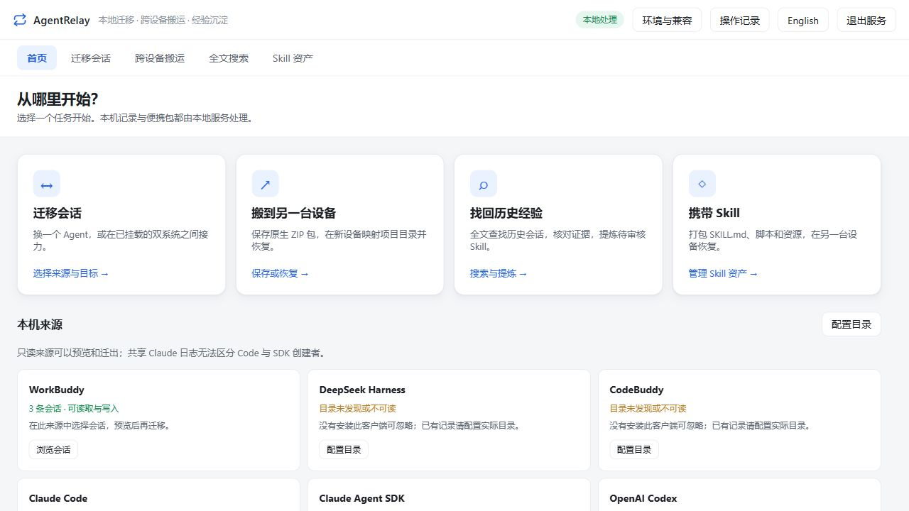

# AgentRelay Portable

[](https://github.com/FriedOnion2/agent-relay-portable/actions/workflows/tests.yml)
[](https://github.com/FriedOnion2/agent-relay-portable/actions/workflows/lint.yml)
[](LICENSE)
[](https://github.com/FriedOnion2/agent-relay-portable/releases)


[中文](README.md) | **English**

**Local-first portable Web & CLI tool to browse, search, export, migrate, and incrementally back up AI coding agent chats and Skills across Windows, macOS, and Linux.**

Supports **Claude Code / Claude Agent SDK · OpenAI Codex · Gemini CLI / Gemini Apps · Google Antigravity · WorkBuddy (Domestic / International) · DeepSeek Harness (DSH) · CodeBuddy (CLI / IDE) · Tencent Yuanbao (JSON exports)** with a bilingual Chinese/English Web UI and CLI.

> 🔒 **Local-first by design:** listens only on localhost, never uploads conversations, and never calls external models. Every migration previews `preserved / degraded / dropped / unknown` differences before writing, and supports undo based on recorded file writes.



## Key capabilities

- **Browse, export, and handoff:** inspect conversations by source, export Markdown, generate **Claude Desktop / Gemini / Antigravity / Yuanbao** continuation TXT files, or export redacted Gemini CLI JSON for `gemini --session-file`.
- **Cross-agent format conversion:** bidirectional conversion across **7 writable targets** — WorkBuddy (Domestic), WorkBuddy AI (International), DSH, Claude Code, Claude Agent SDK, CodeBuddy CLI, and OpenAI Codex (42 directed pairs covered by regression checks), preserving representable text, reasoning, and tool history.
- **Portable archives & incremental backup:** bundle conversations and complete Skill directories into SHA-256 verified native ZIPs; filter by project path and start date, run **incremental backups** against a prior baseline, run **Check backup**, map target directories, and preview conflicts (skip existing IDs by default or restore as independent copies).
- **Local full-text search (SQLite / FTS5):** fast offline search with Chinese short-term segmentation, mixed-language queries, and source / project / date / tool filters (reasoning excluded by default).
- **Evidence-backed Skill drafting:** extract editable Skill drafts from similar completed sessions with cited evidence; review before explicit export or saving — no model calls, auto-install, or script execution.
- **Windows ↔ Ubuntu dual-boot migration:** transfer native records for the same assistant between mounted Windows drives and Ubuntu backups.
- **Zero-dependency portable bundle & bilingual UI:** the universal release bundles Python 3.12 and `zstandard`; switch `English / 中文` in the header or pass `relay --lang en` (`RELAY_LANG=en`) in the CLI.

## Quick start

**Latest stable release: [v1.6.0](https://github.com/FriedOnion2/agent-relay-portable/releases/tag/v1.6.0)** (see [compatibility summary](docs/en/compatibility.md) for client-resume vs. file-level test coverage).

### 1. Portable release (recommended)

Download `AgentRelay-<version>-universal.zip` from [GitHub Releases](https://github.com/FriedOnion2/agent-relay-portable/releases) (**do not** use GitHub's auto-generated Source code archives), extract the full folder, and run the launcher for your OS. No Python/Node.js installation or first-launch downloads required.

| OS | Launcher | Supported systems |
|---|---|---|
| Windows | `启动_AgentRelay.bat` | Windows 10 / 11 x64 |
| macOS | `AgentRelay.app` or `bash 启动_AgentRelay.command` | Apple Silicon: macOS 14+; Intel: macOS 15+ |
| Linux | `bash 启动_AgentRelay.sh` | Ubuntu 22.04+ / glibc 2.35+ x64 |

The browser opens `http://127.0.0.1:8745/` (auto-retrying nearby ports if occupied). Click **Stop service** at the top right to shut down cleanly. For macOS Gatekeeper / unnotarized app steps, see [install and launch](docs/en/install.md).

### 2. Install via pip / pipx (CLI & Web without USB portability)

```sh
pipx install git+https://github.com/FriedOnion2/agent-relay-portable   # or pip install .
relay serve
relay list codex
```

Config, logs, and archives are stored in your per-user data directory (`~/.local/share/agent-relay` on Linux, `~/Library/Application Support/AgentRelay` on macOS, `%APPDATA%\AgentRelay` on Windows), or override with `RELAY_PORTABLE_ROOT`.

### 3. Run from source (Python 3.8+)

```sh
python -m pip install -r requirements-optional.txt              # zstandard is required for compressed DSH logs
python app/cli.py serve                                         # start the web UI
python app/cli.py list codex                                    # list sessions
python app/cli.py export codex <session-id> -o out.md           # export Markdown
python app/cli.py transfer codex <session-id> --to dsh --dry-run   # preview migration without writing
python app/cli.py --lang en list codex                          # English CLI output (or set RELAY_LANG=en)
```

On Ubuntu / macOS, run `Ubuntu首次准备.sh` or `Mac首次准备.command` to create an isolated virtual environment. Full instructions: [install and launch](docs/en/install.md).

## Supported agents & coverage

| Source / Agent | Default session location | Read / Export | Write / Target | Verification & notes |
|---|---|:---:|:---:|---|
| WorkBuddy (Domestic) | `~/.workbuddy/projects` | ✅ | ✅ | File-level read/write & conversion checked |
| WorkBuddy AI (International) | `~/.workbuddy-ai/[user-…/]projects` | ✅ | ✅ | 5.8.4 native read & ZIP roundtrip checked; desktop history index not registered, restored resume unverified |
| DeepSeek Harness (DSH) | `~/.dsh/sessions` | ✅ (v0–v4) | ✅ | Verified in real DSH client |
| CodeBuddy CLI / IDE | `~/.codebuddy/projects`, IDE `Data` | ✅ | CLI | CodeBuddy Code 2.187.0 on Windows recognizes imported IDs; IDE is export-only |
| Claude Code | `~/.claude/projects` | ✅ | ✅ | Export verified; supports **Continue in Claude Desktop** TXT |
| Claude Agent SDK | `~/.claude/projects` (shared with Claude Code) | ✅ | ✅ | Official SDK lists and reads migrated Q&A; labelled "Shared Claude records" |
| OpenAI Codex | `~/.codex/sessions` | ✅ | ✅ | Verified in real Codex client |
| Gemini CLI | `~/.gemini/tmp/<project>/chats/` | ✅ | `gemini --session-file` | Reads JSON/JSONL sessions, tool calls, and reasoning; exports redacted JSON from any source |
| Gemini Apps (Desktop / Web) | Google Takeout JSON / Windows sidebar | ✅ | Handoff TXT | Deduplicated Takeout JSON import & Windows desktop open-chat snapshots; **Continue in Gemini** TXT |
| Google Antigravity | `~/.gemini/antigravity/` | ✅ | Handoff TXT | Prefers `transcript_full.jsonl`, covers `brain/<task>/` & `exports/` artifacts; new-chat handoff TXT |
| Tencent Yuanbao JSON | Portable root `imports/yuanbao` | ✅ | Archive restore only | Import compatible JSON, search, migrate out, and ZIP backup/restore; no desktop DB or cloud access |

### Source notes & verification boundaries

- **Separate WorkBuddy editions:** domestic (`workbuddy` / `~/.workbuddy`) and international (`workbuddy_ai` / `~/.workbuddy-ai`) use separate sources, targets, directory settings, and native archive IDs — never merged automatically. DSH and CodeBuddy also remain separate; see the [WorkBuddy edition transfer matrix](docs/en/compatibility.md#workbuddy-edition-transfer-matrix).
- **Gemini CLI / Apps & Antigravity:**
  - **Gemini CLI:** click **Export Gemini CLI session** or run `relay gemini-session <source> <id> -o session-agentrelay.json`, then load it with `gemini --session-file session-agentrelay.json` (contains redacted Q&A text; excludes source tools, attachments, and reasoning).
  - **Gemini Apps:** on Windows, open **Gemini Apps → Browse sessions** to snapshot loaded Q&A text from the active Gemini desktop chat (duplicates skipped). On all platforms, import **My Activity → Gemini Apps** JSON from [Google Takeout](https://support.google.com/gemini/answer/16920332) with deduplication, and export **Continue in Gemini** TXT.
  - **Google Antigravity:** scans desktop, IDE, and CLI roots by default (or a single configured root in **Environment**), preferring `brain/<session>/.system_generated/logs/transcript_full.jsonl`; restores per artifact/text file and exports **Export TXT for a new chat**.
- **Tencent Yuanbao:** open **Migrate sessions → Tencent Yuanbao** and provide the absolute path to a compatible local JSON export; see the [Yuanbao format guide](docs/reference/formats/yuanbao.md) (Chinese).
- **Verification boundary:** "verified in real client" means opening and continuing a migrated/restored session in the actual vendor client; file-level regression checks do not guarantee native resume compatibility across future vendor updates. See [compatibility summary](docs/en/compatibility.md) and [known limitations](docs/en/limitations.md).

## Documentation

English docs start at [docs/en/README.md](docs/en/README.md); full Chinese index at [docs/README.md](docs/README.md).

| Topic | Document |
|---|---|
| Download, install, launch & quit | [docs/en/install.md](docs/en/install.md) |
| Tutorial: migrate a session (CLI) | [docs/en/migrate-a-session.md](docs/en/migrate-a-session.md) |
| Web workflow, restore & Skill assets | [docs/guide/web-workflow.md](docs/guide/web-workflow.md) (Chinese) |
| Batch storage, conversion & preview | [docs/guide/storage-and-migration.md](docs/guide/storage-and-migration.md) (Chinese) |
| Full-text search & Skill drafting | [docs/guide/search-and-skills.md](docs/guide/search-and-skills.md) (Chinese) |
| Portable archives & Ubuntu dual boot | [docs/guide/portable-storage.md](docs/guide/portable-storage.md) · [docs/guide/ubuntu-dual-boot.md](docs/guide/ubuntu-dual-boot.md) (Chinese) |
| Configuration & troubleshooting | [docs/en/configuration.md](docs/en/configuration.md) · [docs/en/troubleshooting.md](docs/en/troubleshooting.md) |
| Compatibility, limitations & formats | [docs/en/compatibility.md](docs/en/compatibility.md) · [docs/en/limitations.md](docs/en/limitations.md) · [docs/reference/source-formats.md](docs/reference/source-formats.md) (Chinese) |
| Yuanbao compatibility scope | [docs/reference/yuanbao-compatibility.md](docs/reference/yuanbao-compatibility.md) (Chinese) |
| Adapters, plugins & testing | [docs/dev/adapters.md](docs/dev/adapters.md) · [docs/dev/writing-a-plugin.md](docs/dev/writing-a-plugin.md) · [docs/dev/testing.md](docs/dev/testing.md) (Chinese) |
| CLI reference | [docs/en/cli.md](docs/en/cli.md) (Quick start: [使用说明.md](使用说明.md)) |

## Contributing

Issues and pull requests are welcome — please read [CONTRIBUTING.md](CONTRIBUTING.md) first. Report security issues privately via [SECURITY.md](SECURITY.md). See [CHANGELOG.md](CHANGELOG.md) for release history and [docs/dev/maintainers.md](docs/dev/maintainers.md) for maintainer workflows.

## License

[MIT License](LICENSE)
