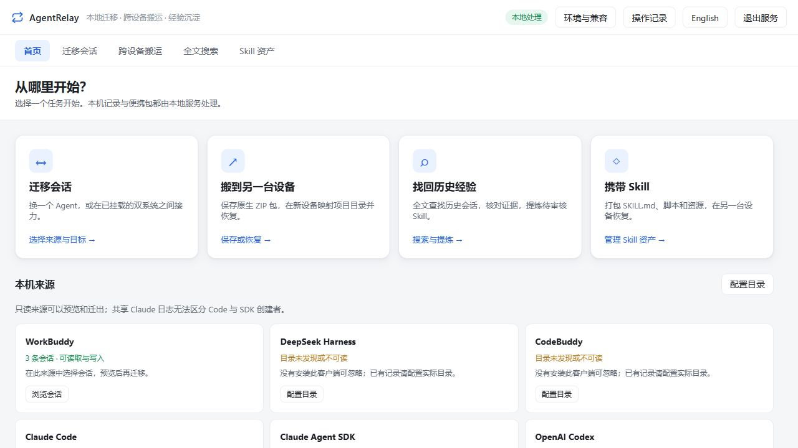

# AgentRelay Portable

[](https://github.com/FriedOnion2/agent-relay-portable/actions/workflows/tests.yml)
[](https://github.com/FriedOnion2/agent-relay-portable/actions/workflows/lint.yml)
[](LICENSE)
[](https://github.com/FriedOnion2/agent-relay-portable/releases)


**中文** | [English](README.en.md)

**在本机浏览、搜索、导出和跨软件迁移 AI 编程助手对话与 Skill，并支持打包到移动盘在 Windows / macOS / Linux 间恢复与增量备份。**

支持 **Claude Code / Claude Agent SDK · OpenAI Codex · Gemini CLI / Gemini Apps · Google Antigravity · WorkBuddy（国内版 / 国际版）· DeepSeek Harness (DSH) · CodeBuddy (CLI / IDE) · 腾讯元宝（JSON 导出）**，提供中英文网页界面与命令行。

> 🔒 **纯本地处理**：服务仅监听本机回环地址，不上传会话、不调用云端模型；迁移前先预览「保留 / 降级 / 丢弃 / 未知」差异，确认后才写入，并支持按真实写入清单撤销。



## 核心能力

- **浏览、导出与接力续聊**：按来源浏览、预览会话并导出 Markdown；支持生成 **Claude 桌面 / Gemini / Antigravity / 元宝** 新聊天接力 TXT，以及可通过 `gemini --session-file` 导入的脱敏 Gemini CLI 会话 JSON。
- **跨软件格式迁移**：在 **WorkBuddy 国内版、WorkBuddy AI 国际版、DSH、Claude Code、Claude Agent SDK、CodeBuddy CLI、OpenAI Codex** 7 个可写目标间双向转换（42 组有向组合已纳入回归校验），保留可表达的正文、思考与工具历史。
- **跨设备便携与增量备份**：将对话与完整 Skill 目录打包为带 SHA-256 清单的原生 ZIP；支持按项目路径与起始日期筛选、基于基线包的**增量备份**、**备份体检**、目录映射与恢复冲突预览（默认跳过已有 ID，也可恢复为独立副本）。
- **本地全文搜索（SQLite / FTS5）**：支持中文短词、中英混合查询与来源 / 项目 / 时间 / 工具筛选，默认排除思考内容。
- **证据驱动 Skill 提炼**：从多条相似历史会话中提炼带证据出处的 Skill 草稿，审阅后手动导出或存入资产库，不调用模型、不自动安装或执行脚本。
- **Windows ↔ Ubuntu 双系统互迁**：在双系统或备份目录间直接搬迁同款软件的原生记录。
- **零依赖便携与中英双语**：Release 总包内置 Python 3.12 与 `zstandard`，解压即用；网页右上角一键切换 `中文 / English`，CLI 可通过 `relay --lang en` 或 `RELAY_LANG=en` 切换。

## 快速开始

**最新正式版：[v1.6.0](https://github.com/FriedOnion2/agent-relay-portable/releases/tag/v1.6.0)**（各客户端实测与文件层边界见 [兼容状态](docs/reference/compatibility.md)）。

### 1. 开箱即用（推荐）

前往 [Releases](https://github.com/FriedOnion2/agent-relay-portable/releases) 下载 `AgentRelay-<版本>-universal.zip`（**不要**选择 GitHub 自动生成的 Source code 压缩包），完整解压后运行启动器即可。无需另装 Python / Node.js，首次启动不联网下载。

| 设备 | 启动入口 | 支持范围 |
|---|---|---|
| Windows | `启动_AgentRelay.bat` | Windows 10 / 11 x64 |
| macOS | `AgentRelay.app` 或 `bash 启动_AgentRelay.command` | Apple Silicon：macOS 14+；Intel：macOS 15+ |
| Linux | `bash 启动_AgentRelay.sh` | Ubuntu 22.04+ / glibc 2.35+ x64 |

启动后自动打开本机页面（默认 `http://127.0.0.1:8745/`，端口占用时自动顺延重试）；退出请点击网页右上角「退出服务」。macOS 未公证提示处理见 [安装与启动](docs/guide/install.md)。

### 2. 使用 pip / pipx 安装（CLI 与网页）

适合不需要 U 盘便携、仅在本机使用命令行和网页的用户：

```sh
pipx install git+https://github.com/FriedOnion2/agent-relay-portable   # 或 pip install .
relay serve
relay list codex
```

配置、日志与存储包默认存放于各系统用户数据目录（Linux `~/.local/share/agent-relay`，macOS `~/Library/Application Support/AgentRelay`，Windows `%APPDATA%\AgentRelay`），可通过 `RELAY_PORTABLE_ROOT` 指定自定义位置。

### 3. 从源码运行（Python 3.8+）

```sh
python -m pip install -r requirements-optional.txt              # 读写 DSH 压缩历史需要 zstandard
python app/cli.py serve                                         # 启动网页界面
python app/cli.py list codex                                    # 列出会话
python app/cli.py export codex <会话id> -o out.md               # 导出 Markdown
python app/cli.py transfer codex <会话id> --to dsh --dry-run    # 迁移前只读预览
python app/cli.py --lang en list codex                          # 英文输出（或设 RELAY_LANG=en）
```

Ubuntu / macOS 可使用 `Ubuntu首次准备.sh` / `Mac首次准备.command` 自动建立隔离环境，完整步骤见 [安装与启动](docs/guide/install.md)。

## 支持的助手与范围

| 来源 / Agent | 默认会话位置 | 读取 / 导出 | 写入 / 迁移目标 | 验证与说明 |
|---|---|:---:|:---:|---|
| WorkBuddy 国内版 | `~/.workbuddy/projects` | ✅ | ✅ | 文件层读写与双向转换已核对；详见互传矩阵 |
| WorkBuddy AI 国际版 | `~/.workbuddy-ai/[user-…/]projects` | ✅ | ✅ | 5.8.4 原生读取及 ZIP 往返实测；不登记桌面索引，恢复副本续聊未通过验证 |
| DeepSeek Harness (DSH) | `~/.dsh/sessions` | ✅（v0–v4） | ✅ | 真实客户端续聊已验证 |
| CodeBuddy CLI / IDE | `~/.codebuddy/projects` 等 | ✅ | CLI | CodeBuddy Code 2.187.0 在 Windows 识别迁入 ID；IDE 仅迁出 |
| Claude Code | `~/.claude/projects` | ✅ | ✅ | 导出已验证；支持「接力到 Claude 桌面」TXT |
| Claude Agent SDK | `~/.claude/projects`（与 Claude Code 共享） | ✅ | ✅ | 官方 SDK 可列出并读取迁入问答；界面标为“共享 Claude 记录” |
| OpenAI Codex | `~/.codex/sessions` | ✅ | ✅ | 真实客户端续聊已验证 |
| Gemini CLI | `~/.gemini/tmp/<项目>/chats/` | ✅ | `gemini --session-file` | 读取 JSON/JSONL 会话、工具与思考摘要；支持任意来源导出脱敏会话 JSON |
| Gemini Apps（桌面 / 网页） | Google Takeout JSON / Windows 桌面侧栏 | ✅ | 接力 TXT | 支持 Takeout 活动 JSON 去重导入与 Windows 桌面当前聊天快照；支持接力到新聊天 |
| Google Antigravity | `~/.gemini/antigravity/` | ✅ | 接力 TXT | 优先读取 `transcript_full.jsonl`，覆盖 `brain/<任务>/` 与 `exports/` 产物；支持接力 TXT |
| 腾讯元宝 JSON 导出 | 便携目录 `imports/yuanbao` | ✅ | 仅导出文件存包恢复 | 从兼容 JSON 迁出、搜索与 ZIP 备份恢复；不直读桌面库或云端 |

### 来源说明与验证边界

- **WorkBuddy 双版本独立识别**：国内版（`workbuddy` / `~/.workbuddy`）与国际版（`workbuddy_ai` / `~/.workbuddy-ai`）拥有独立的来源、目标、目录配置与原生包标识，不自动混合；DSH、CodeBuddy 亦保持独立。详见 [互传验证矩阵](docs/reference/compatibility.md#workbuddy-国内版与国际版互传)。
- **Gemini CLI / Apps 与 Antigravity**：
  - **Gemini CLI**：在会话详情点「导出 Gemini CLI 会话」或运行 `relay gemini-session <来源> <ID> -o session-agentrelay.json`，在目标项目执行 `gemini --session-file session-agentrelay.json` 即可在项目列表加载（含脱敏问答正文，不含工具/附件/思考）。
  - **Gemini Apps**：Windows 用户可在「Gemini Apps → 浏览会话」刷新并保存桌面版当前已加载的问答快照（自动跳过重复内容）；全平台均可通过 [Google Takeout](https://support.google.com/gemini/answer/16920332) 导出「我的活动 → Gemini Apps」JSON 后去重导入，并用「接力到 Gemini」TXT 在新聊天继续。
  - **Google Antigravity**：默认扫描桌面版、IDE 与 CLI 三个数据目录（可在「环境设置」限定目录），优先读取 `brain/<会话>/.system_generated/logs/transcript_full.jsonl`；恢复单位为单份产物或文本，可通过「导出新聊天接力 TXT」带回上下文。
- **腾讯元宝**：入口位于「迁移会话 → 腾讯元宝」，填入兼容 JSON 文件的本机绝对路径即可导入，详见 [元宝使用与格式说明](docs/reference/formats/yuanbao.md)。
- **验证边界**：“实机验证”指用真实客户端打开并续聊过迁移或恢复后的会话；其余来源为文件层读写与回归验证，厂商格式可能随版本变化，详见 [兼容状态](docs/reference/compatibility.md) 与 [当前限制](docs/reference/limitations.md)。

## 文档

完整索引见 [docs/README.md](docs/README.md)，按使用指南（`guide/`）、参考（`reference/`）、开发（`dev/`）与调研（`research/`）分类：

| 主题 | 文档 |
|---|---|
| 下载、安装、启动与退出 | [docs/guide/install.md](docs/guide/install.md) |
| 网页任务导航、恢复与草稿打包 | [docs/guide/web-workflow.md](docs/guide/web-workflow.md) |
| 批量存储、跨软件 / 双系统迁移与预览 | [docs/guide/storage-and-migration.md](docs/guide/storage-and-migration.md) |
| 全文搜索与 Skill 草稿提炼 | [docs/guide/search-and-skills.md](docs/guide/search-and-skills.md) |
| 便携存储、Ubuntu 双系统 | [docs/guide/portable-storage.md](docs/guide/portable-storage.md) · [docs/guide/ubuntu-dual-boot.md](docs/guide/ubuntu-dual-boot.md) |
| 配置与数据目录、故障排查 | [docs/guide/configuration.md](docs/guide/configuration.md) · [docs/guide/troubleshooting.md](docs/guide/troubleshooting.md) |
| 兼容状态、已知限制、来源格式 | [docs/reference/compatibility.md](docs/reference/compatibility.md) · [docs/reference/limitations.md](docs/reference/limitations.md) · [docs/reference/source-formats.md](docs/reference/source-formats.md) |
| 腾讯元宝接入范围 | [docs/reference/yuanbao-compatibility.md](docs/reference/yuanbao-compatibility.md) |
| 适配器与插件开发、测试 | [docs/dev/adapters.md](docs/dev/adapters.md) · [docs/dev/writing-a-plugin.md](docs/dev/writing-a-plugin.md) · [docs/dev/testing.md](docs/dev/testing.md) |
| 命令行完整说明 | [命令行参考](docs/reference/cli.md)（快速上手见 [使用说明.md](使用说明.md)） |

## 参与贡献

欢迎提 issue 与 PR：请先阅读 [CONTRIBUTING.md](CONTRIBUTING.md)。安全问题请按 [SECURITY.md](SECURITY.md) 私密报告。版本变更见 [CHANGELOG.md](CHANGELOG.md)，维护流程见 [docs/dev/maintainers.md](docs/dev/maintainers.md)。

## 许可

[MIT License](LICENSE)
